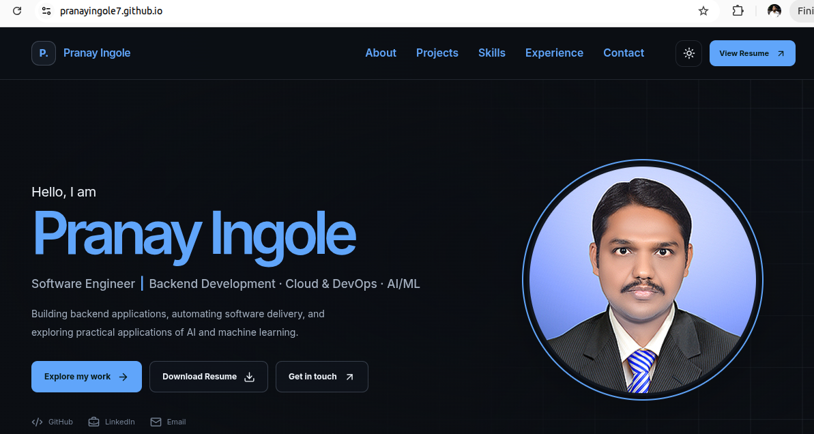

# Pranay Ingole — Software Engineer Portfolio

A responsive personal portfolio showcasing my work in backend engineering,
full-stack development, DevOps automation, and practical AI integration.

**Live Portfolio:** [pranayingole7.github.io](https://pranayingole7.github.io/)

## Preview



## Built With

- React and TypeScript
- Vite
- Custom CSS with responsive layouts and dark/light themes
- Lucide icons
- GitHub Actions and GitHub Pages

## Featured Projects

### Git-Prasaaran — Documentation Publishing Platform

A Git-backed Markdown documentation platform featuring a React and TypeScript
frontend, Spring Boot REST APIs, GitHub webhook processing, Redis caching,
and automated deployment.

- [Source Code](https://github.com/PranayIngole7/git-prasaaran)
- [Live Application](https://git-prasaaran.netlify.app/)

### PayFlow — Digital Wallet and Payment Platform

A digital wallet and payment platform focused on idempotent payment operations,
transaction integrity, double-entry ledger postings, and reconciliation.

- [Source Code](https://github.com/PranayIngole7/payflow)

### Cloud-Native Thumbnail Pipeline

A containerized image-processing API built with FastAPI and Pillow, featuring
S3-compatible storage, health checks, failure handling, and automated tests.

## Run Locally

### Prerequisites

- Node.js 22 or a compatible supported version
- npm

### Setup

```bash
git clone https://github.com/PranayIngole7/PranayIngole7.github.io.git
cd PranayIngole7.github.io
npm ci
npm run dev
```

Vite prints the local development URL in the terminal, usually
`http://localhost:5173/`.

### Quality Checks

```bash
npm run lint
npm run build
npm run preview
```

The production build is generated in the `dist/` directory.

## Deployment

GitHub Actions automatically builds the Vite application and deploys the
generated `dist/` directory to GitHub Pages when changes are pushed to `main`.

## Contact

- [GitHub](https://github.com/PranayIngole7)
- [LinkedIn](https://www.linkedin.com/in/pranayingole1/)
- [Email](mailto:pranayingole1@gmail.com)

---

Built by Pranay Ingole.
